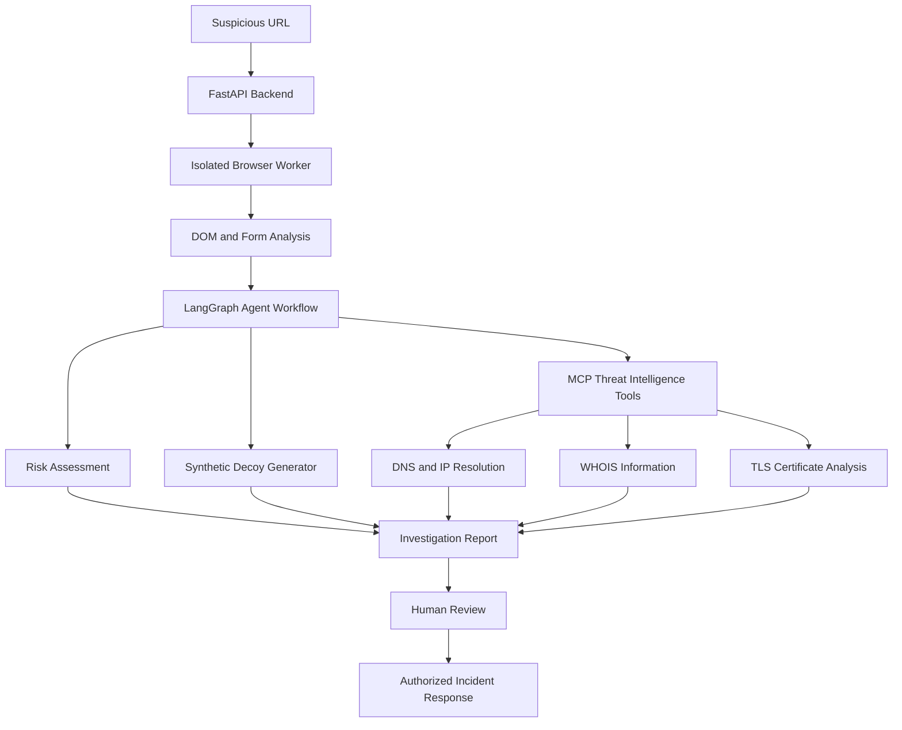

# 🛡️ TrapWire — Autonomous Anti-Phishing Honeypot & Threat Intelligence Agent

### Active Cyber Defense Powered by Agentic AI, LangGraph, MCP & Docker

**Detect. Investigate. Deceive. Defend.**

TrapWire is an AI-powered cybersecurity project designed to investigate suspicious URLs, identify potential phishing behavior, analyze domain infrastructure, and assist security teams with threat intelligence and incident response.

By combining Agentic AI, browser automation, Model Context Protocol (MCP), and containerized execution, TrapWire explores a proactive approach to phishing investigation.

---

## 📌 Table of Contents

- [Overview](#-overview)
- [Key Features](#-key-features)
- [System Architecture](#️-system-architecture)
- [Workflow](#-workflow)
- [Technology Stack](#️-technology-stack)
- [Project Structure](#-project-structure)
- [Installation and Setup](#-installation-and-setup)
- [Running the Project](#-running-the-project)
- [API Documentation](#-api-documentation)
- [Security Considerations](#-security-considerations)
- [Testing and Evaluation](#-testing-and-evaluation)
- [Future Enhancements](#-future-enhancements)
- [Resume Highlights](#-resume-highlights)
- [Responsible Use](#️-responsible-use)
- [Author](#-author)

---

## 🚀 Overview

Traditional anti-phishing solutions often focus on identifying and blocking malicious URLs. However, phishing campaigns can quickly evolve through replacement domains, deceptive login pages, and constantly changing infrastructure.

**TrapWire** explores a more proactive approach by combining automated website inspection, agentic reasoning, threat intelligence, and controlled honeypot experimentation.

The platform is designed to:

- Investigate suspicious URLs in a restricted browser environment.
- Analyze HTML forms and identify potential credential-harvesting indicators.
- Coordinate investigation tasks using a LangGraph-based agent workflow.
- Generate synthetic decoy inputs for authorized honeypot experiments.
- Collect domain and infrastructure intelligence using MCP tools.
- Generate structured investigation reports and assist with abuse reporting.

### 🎯 Project Objectives

1. **Proactive Detection:** Identify suspicious website behavior beyond basic URL blocklisting.
2. **Agentic Investigation:** Coordinate multiple analysis steps through a stateful AI workflow.
3. **Threat Intelligence:** Collect useful information about domains, IP addresses, registrars, and TLS certificates.
4. **Sandboxed Analysis:** Reduce the risk of exposing the host system to potentially malicious web content.
5. **Automated Reporting:** Prepare evidence-based reports for security analysts and authorized incident responders.

---

## ✨ Key Features

### 🔍 1. Suspicious URL Investigation

- Accepts suspicious URLs for investigation.
- Uses Playwright for automated browser interaction.
- Inspects page structure, HTML forms, and input field metadata.
- Identifies indicators associated with suspicious login pages.
- Supports investigation of websites in a controlled environment.

### 🧠 2. Agentic AI with LangGraph

- Organizes investigation tasks into a stateful workflow.
- Coordinates website analysis, threat intelligence collection, and risk assessment.
- Supports conditional routing between investigation steps.
- Combines findings into a structured threat assessment.
- Enables modular agent workflows that can be extended over time.

### 🧪 3. Synthetic Decoy Generation

- Generates synthetic, non-real credentials for controlled honeypot experiments.
- Supports testing of suspected credential-collection behavior.
- Avoids using genuine user credentials or sensitive personal information.
- Allows decoy submission only when explicitly authorized and safely configured.

### 🌐 4. Threat Intelligence with MCP

TrapWire can use Model Context Protocol (MCP) to expose investigation tools to an AI agent through a standardized interface.

| MCP Tool | Description |
|---|---|
| `resolve_target_ip` | Resolves a domain to its associated IP addresses. |
| `query_whois_registrar` | Retrieves available domain registration information. |
| `analyze_ssl_cert` | Inspects TLS certificate metadata and validity. |
| `collect_domain_intelligence` | Combines available infrastructure indicators. |

Tool availability depends on the configured MCP server, external services, and actual implementation.

### 🚨 5. Abuse Reporting and Incident Response

- Organizes investigation findings into structured reports.
- Records suspicious URLs and relevant technical indicators.
- Helps prepare abuse complaints for hosting providers and domain registrars.
- Supports human review before external reports are submitted.
- Provides a foundation for integrating authorized incident response workflows.

Automated report delivery and takedown integrations require appropriate implementation and provider support.

### 🐳 6. Docker-Based Sandboxed Execution

- Supports containerized browser analysis.
- Allows non-root execution and configurable resource limits.
- Enables restricted network access through container configuration.
- Supports temporary analysis environments and cleanup after execution.

Docker provides an additional security layer but does not guarantee complete isolation against every possible exploit.

### ⚡ 7. FastAPI Backend

- Exposes HTTP endpoints for investigation requests.
- Supports request validation using Pydantic.
- Provides interactive API documentation through Swagger UI.
- Enables integration with dashboards and external security tools.

---

## 🏗️ System Architecture



### 🔄 Investigation Workflow

**Step 1 — URL Submission**

The user submits a suspicious URL through the API or demo interface.

**Step 2 — Sandboxed Browser Analysis**

A browser worker opens the target in a restricted environment and inspects relevant website elements.

**Step 3 — Form and Behavior Analysis**

The system extracts form metadata, input fields, page structure, and other relevant indicators.

**Step 4 — Agentic Reasoning**

The LangGraph workflow coordinates investigation tasks and evaluates the collected evidence.

**Step 5 — Threat Intelligence Collection**

Configured MCP tools retrieve available DNS, IP, WHOIS, and TLS certificate information.

**Step 6 — Risk Assessment**

The system combines available evidence into a structured investigation result.

**Step 7 — Reporting and Response**

A report is generated for review. External submissions or consequential actions require appropriate authorization.

---

## 🛠️ Technology Stack

| Category | Technologies |
|---|---|
| Programming Language | Python |
| Agentic AI | LangGraph |
| LLM Integration | Configurable language model provider |
| Tool Integration | Model Context Protocol (MCP) |
| Browser Automation | Playwright |
| Backend Framework | FastAPI |
| Data Validation | Pydantic |
| Containerization | Docker, Docker Compose |
| Threat Intelligence | DNS, WHOIS, TLS |
| API Documentation | Swagger UI, OpenAPI |
| Version Control | Git, GitHub |

---

## 📂 Project Structure

The following is a suggested project structure. Adjust it to match the files actually present in your repository.

```text
TrapWire/
│
├── main.py
├── run_demo.py
├── requirements.txt
├── README.md
├── .env.example
├── .gitignore
│
├── agents/
│   ├── __init__.py
│   ├── graph.py
│   ├── nodes.py
│   └── state.py
│
├── sandbox/
│   ├── browser_worker.py
│   └── browser_analyzer.py
│
├── mcp_server/
│   ├── server.py
│   └── threat_tools.py
│
├── api/
│   ├── __init__.py
│   └── routes.py
│
├── threat_intelligence/
│   ├── dns_lookup.py
│   ├── whois_lookup.py
│   └── tls_analysis.py
│
├── reporting/
│   └── incident_report.py
│
├── docker/
│   ├── Dockerfile
│   └── docker-compose.yml
│
└── tests/
    ├── test_api.py
    ├── test_analysis.py
    └── test_threat_tools.py
```

---

## ⚡ Installation and Setup

### Prerequisites

Before running TrapWire, ensure that you have:

- Python 3.11 or another version compatible with the project dependencies.
- Git installed on your system.
- Docker Desktop installed for containerized execution.
- Playwright and its required browser dependencies.
- API credentials for any optional LLM or threat intelligence providers.

### 1. Clone the Repository

```bash
git clone https://github.com/YOUR_USERNAME/TrapWire.git
cd TrapWire
```

Replace `YOUR_USERNAME` with your GitHub username and use the actual repository URL.

### 2. Create a Virtual Environment

For Windows PowerShell:

```powershell
python -m venv .venv
.\.venv\Scripts\Activate.ps1
```

Alternatively, use Command Prompt:

```bat
.venv\Scripts\activate.bat
```

### 3. Install Dependencies

```bash
python -m pip install --upgrade pip
pip install -r requirements.txt
```

Install the Playwright Chromium browser if the project uses Playwright:

```bash
python -m playwright install chromium
```

### 4. Configure Environment Variables

Create a local `.env` file if your implementation requires environment variables.

Example `.env.example`:

```dotenv
LLM_API_KEY=
MCP_SERVER_URL=
THREAT_INTEL_API_KEY=
```

Use the variable names expected by your code. Leave optional values empty when the corresponding integration is not configured.

**Important:** Never commit real API keys, passwords, or private credentials to GitHub.

---

## ▶️ Running the Project

### 1. Run the Interactive Demo

From the project root:

```bash
python run_demo.py
```

If your demo supports a URL command-line argument:

```bash
python run_demo.py "https://example.com"
```

Start with a local test page or an authorized test environment.

### 2. Start the FastAPI Backend

If `main.py` starts the server:

```bash
python main.py
```

If `main.py` exposes a FastAPI application object named `app`, you can alternatively run:

```bash
uvicorn main:app --host 127.0.0.1 --port 8000
```

### 3. Launch Docker Services

If your repository contains the corresponding Docker Compose file:

```bash
docker compose -f docker/docker-compose.yml up --build
```

To stop the services:

```bash
docker compose -f docker/docker-compose.yml down
```

**Note:** The commands above assume the specified scripts and configuration files exist. Adapt the commands to your actual implementation.

---

## 🔌 API Documentation

TrapWire is designed to expose a REST API through FastAPI.

Once the backend is running locally, access:

- **Swagger UI:** http://127.0.0.1:8000/docs
- **ReDoc:** http://127.0.0.1:8000/redoc
- **OpenAPI Schema:** http://127.0.0.1:8000/openapi.json

These routes are available when the corresponding FastAPI documentation settings are enabled.

### Example Scan Request

If the application implements `POST /api/v1/scan`, the request body may look like this:

```json
{
  "url": "https://example.com"
}
```

Example request using Python:

```python
import requests

url = "http://127.0.0.1:8000/api/v1/scan"

payload = {
    "url": "https://example.com"
}

response = requests.post(url, json=payload, timeout=30)

print("Status Code:", response.status_code)
print(response.text)
```

The endpoint, accepted fields, and response format must match your actual FastAPI implementation.

---

## 🔐 Security Considerations

TrapWire is designed around a defense-in-depth approach.

- **Least Privilege:** Run browser workers as non-root users with restricted permissions.
- **Network Restrictions:** Limit outbound connections and block access to private, loopback, link-local, and cloud metadata addresses unless explicitly required for an authorized test.
- **SSRF Protection:** Validate submitted URLs, check resolved IP addresses, and revalidate redirects to reduce server-side request forgery risks.
- **Resource Limits:** Configure CPU, memory, process, and execution-time limits.
- **Ephemeral Execution:** Dispose of temporary browser sessions and containers after analysis.
- **Secret Management:** Keep API keys and credentials outside source control.
- **Human Approval:** Require authorization before submitting external abuse reports or executing consequential actions.
- **Audit Logging:** Record investigation steps, tool calls, findings, and errors.

Security controls must be implemented and tested. Containerization alone does not guarantee complete protection against malicious websites or browser exploits.

---

## 🧪 Testing and Evaluation

The project can be evaluated using a controlled dataset containing labeled phishing and legitimate pages.

Suggested evaluation metrics include:

| Metric | Purpose |
|---|---|
| Precision | Measures how many flagged pages are actually phishing pages. |
| Recall | Measures how many phishing pages are successfully identified. |
| F1-Score | Balances precision and recall. |
| False Positive Rate | Measures how often legitimate pages are incorrectly flagged. |
| Analysis Latency | Measures the time required to investigate a URL. |
| Tool Reliability | Measures successful execution of configured intelligence tools. |

Additional tests should cover:

- URL validation and redirect handling.
- DOM extraction and form analysis.
- MCP tool failures and timeout handling.
- API request validation.
- Container cleanup and resource limits.
- SSRF protection and restricted network access.

Report measured results only after running appropriate experiments.

---

## 🚀 Future Enhancements

- [ ] Interactive threat investigation dashboard.
- [ ] Explainable risk scoring with evidence for each indicator.
- [ ] Additional threat intelligence provider integrations.
- [ ] Security Information and Event Management (SIEM) integration.
- [ ] Configurable alerting and notifications.
- [ ] Phishing campaign clustering and domain similarity analysis.
- [ ] Automated regression tests for SSRF and sandbox protections.
- [ ] Human-approved abuse report submission.
- [ ] Investigation history and downloadable incident reports.
- [ ] Improved monitoring, logging, and performance evaluation.

---

## 💼 Resume Highlights

**TrapWire — Autonomous Anti-Phishing Honeypot & Threat Intelligence Agent**

**Tech Stack:** Python, LangGraph, MCP, Docker, FastAPI, Playwright, Pydantic

- Designed an agentic cybersecurity workflow to investigate suspicious URLs and analyze website form structures using browser automation.
- Developed a LangGraph-based investigation pipeline to coordinate phishing indicator analysis, risk assessment, and structured threat reporting.
- Integrated MCP-based tool interfaces for domain resolution, WHOIS information retrieval, and TLS certificate inspection.
- Designed a containerized browser analysis workflow with restricted privileges, configurable resource limits, and ephemeral execution.
- Built a FastAPI interface for investigation requests and interactive API documentation.

Include only the features you have implemented and tested in your actual project.

---

## ⚖️ Responsible Use

TrapWire is intended for authorized cybersecurity research, defensive threat analysis, and controlled honeypot experiments.

- Investigate only systems you own or have explicit permission to assess.
- Never submit genuine user credentials or sensitive personal information to suspicious websites.
- Do not use decoy submissions to disrupt third-party services or interfere with unrelated users.
- Obtain appropriate authorization before contacting providers or submitting abuse reports.
- Follow applicable laws, provider terms, and organizational security policies.

---

## 👩‍💻 Author

**Shraddha Patel**

M.Sc. Data Science | Indian Institute of Information Technology, Lucknow

Interested in Generative AI, Agentic AI, Large Language Models, Retrieval-Augmented Generation (RAG), and AI-powered security systems.

- **GitHub:** [ShraddhaPatel1906](https://github.com/ShraddhaPatel1906)
- **LinkedIn:** [Shraddha Patel](https://www.linkedin.com/in/shraddha-patel-32897336b/)

---

### ⭐ Project Vision

**TrapWire — Turning Passive Phishing Detection into Proactive Threat Investigation.**

